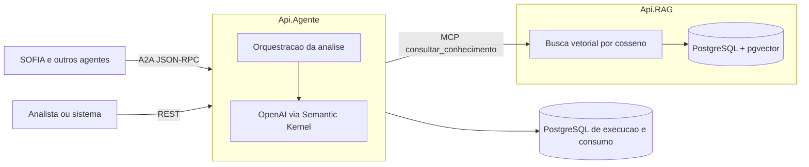
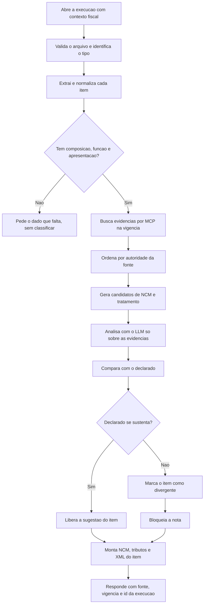

# Agente de Classificação Fiscal de Produtos

Um agente de IA que sugere, identifica e audita a classificação NCM e o tratamento
tributário de produtos, a partir de descrições, notas fiscais, planilhas, laudos e
documentação técnica. Ele devolve uma resposta estruturada e rastreável, com a fonte
de cada sugestão, e pode bloquear uma nota quando a classificação declarada não se
sustenta no produto.

O projeto nasceu no treinamento INFIS/COTI e expõe o agente para a plataforma SOFIA
por meio do protocolo A2A, de forma que outros agentes e orquestradores consigam
conversar com ele.

> Importante: o estado "sugestão liberada para uso" significa apenas que a sugestão
> pode ser consumida por uma pessoa ou por um sistema. Ele não é um certificado de
> conformidade fiscal.

## Visão geral

A solução é formada por dois serviços independentes que conversam apenas por contratos
bem definidos:

- **Api.Agente**: recebe os pedidos de análise, orquestra todo o fluxo, fala com o
  modelo de linguagem, valida a resposta e publica o agente para a SOFIA.
- **Api.RAG**: guarda a base de conhecimento (legislação, notas, NCM, casos
  confirmados), gera os embeddings e responde às buscas por similaridade.

Cada serviço é dono exclusivo dos seus dados. A Api.Agente nunca acessa o banco da
Api.RAG diretamente; toda consulta de conhecimento passa por uma ferramenta MCP.



## Como a análise funciona

O caminho de uma análise é sempre o mesmo, do pedido até a resposta. De forma resumida:



A ordem de autoridade das evidências é fixa: primeiro a legislação vigente, depois as
notas e as Regras Gerais de Interpretação, em seguida o caso corporativo confirmado e,
por último, o texto do fornecedor. Quando duas fontes da mesma faixa empatam, o item
vai para revisão humana em vez de escolher um vencedor inventado.

O agente nunca cria código, alíquota, dispositivo legal ou referência. Se não houver
evidência suficiente, ele declara a limitação e não escolhe um candidato.

## Integração com a SOFIA (A2A)

A Api.Agente publica um Agent Card e atende chamadas A2A no perfil JSON-RPC 0.3.0.

- `GET /.well-known/agent-card.json` descreve o agente, a capacidade `analisar_documentos`
  e o endpoint de execução.
- `POST /a2a` recebe `message/send`, `tasks/get` e `tasks/cancel`.
- O Agent Card e o `/a2a` exigem `Authorization: Bearer`. Sem a chave, respondem 401.

O segredo de entrada vem da variável `SOFIA_A2A_TOKEN` e é comparado em tempo constante.
Ele nunca aparece no código nem em arquivo versionado.

O contrato de negócio e os dados de cadastro na SOFIA estão em
[docs/sofia-a2a-cadastro.md](docs/sofia-a2a-cadastro.md).

## Base de conhecimento (RAG)

A Api.RAG recebe documentos com origem, identificação, versão, faixa de autoridade e
vigência. Ela gera os chunks e os embeddings, guarda tudo no PostgreSQL com a extensão
pgvector e responde buscas por similaridade de cosseno.

Versões diferentes de um mesmo documento convivem. Uma consulta por uma data só devolve
os chunks cuja vigência contém aquela data, sem misturar versões.

As fontes oficiais recomendadas (NCM, TIPI, CEST, NESH, Soluções de Consulta e outras)
estão catalogadas em [docs/fontes-conhecimento-fiscal.md](docs/fontes-conhecimento-fiscal.md).

## Tecnologias

- .NET 10 com ASP.NET Core
- OpenAI com Semantic Kernel para function calling
- Model Context Protocol (MCP) para a fronteira entre os serviços
- PostgreSQL com pgvector para a busca vetorial
- Protocolo A2A JSON-RPC 0.3.0 para a integração com a SOFIA
- xUnit para os testes

## Estrutura do projeto

```
.
├── src/
│   ├── Api.Agente/        Orquestracao, analise, A2A e consumo
│   └── Api.RAG/           Ingestao, embeddings, busca e MCP
├── tests/
│   ├── Api.Agente.Tests/
│   └── Api.RAG.Tests/
├── tools/
│   └── carga-ncm/         Carregador da tabela NCM para o RAG
├── data/
│   └── ncm/               Tabela NCM oficial e sua procedencia
├── specs/                 Especificacoes por funcionalidade (SDD)
├── docs/                  Fontes fiscais, cadastro A2A e checklist
├── .specify/memory/       Constituicao do projeto
├── docker-compose.yml     Bancos locais
├── vercel.json            Dois servicos container, roteados por host
└── Dockerfile*.vercel     Imagens de publicacao
```

## Rodando localmente

Pré-requisitos: .NET 10 SDK e Docker.

1. Suba os bancos locais:

```bash
docker compose up -d
```

2. Rode a Api.RAG e abra o Swagger:

```bash
dotnet run --project src/Api.RAG
```

3. Em outro terminal, rode a Api.Agente:

```bash
dotnet run --project src/Api.Agente
```

Cada serviço redireciona a raiz para o seu Swagger, onde você consegue experimentar as
rotas. A Api.Agente também publica o Agent Card em `/.well-known/agent-card.json`.

## Configuração

Os segredos e os parâmetros vêm do ambiente, nunca do repositório. Copie o
[.env.example](.env.example) e preencha os valores no seu ambiente ou no painel do
provedor. Os principais:

| Variável | Serviço | Para que serve |
| --- | --- | --- |
| `ConnectionStrings__Agente` | Api.Agente | Banco de execução e consumo |
| `OpenAI__ApiKey` | Api.Agente | Chave do provedor do modelo |
| `Conhecimento__McpUrl` | Api.Agente | Endereço MCP da Api.RAG |
| `SOFIA_A2A_TOKEN` | Api.Agente | Token Bearer de entrada da SOFIA |
| `ConnectionStrings__Rag` | Api.RAG | Banco de vetores com pgvector |
| `Ingestao__Chave` | Api.RAG | Chave para ingerir documentos |
| `Embedding__Model` e afins | Api.RAG | Modelo e parâmetros de busca |

Os valores de chunk, dimensão, topK e limiar são pontos de partida. A recomendação é
avaliá-los com exemplos reais antes de tratar como padrão de produção.

## Testes

Rode a suíte completa de um serviço com:

```bash
dotnet test tests/Api.Agente.Tests/Api.Agente.Tests.csproj
```

```bash
dotnet test tests/Api.RAG.Tests/Api.RAG.Tests.csproj
```

Os testes não chamam a OpenAI nem um PostgreSQL real; eles usam dublês e dados sintéticos.

## Publicação na nuvem

A publicação usa Vercel para os dois serviços e Neon para os bancos. O `vercel.json`
declara dois serviços container e os separa por host: um domínio para a Api.Agente e
outro para a Api.RAG. O passo a passo completo, com Neon, extensão pgvector e variáveis,
está em [docs/publicacao-checklist.md](docs/publicacao-checklist.md).

## Carregando a tabela NCM

A pasta [tools/carga-ncm/](tools/carga-ncm/) tem um script que lê a tabela NCM oficial e
a ingere na Api.RAG, um documento por código, pela rota de administração. Ele é
idempotente: rodar de novo não duplica nada. Veja o
[README do carregador](tools/carga-ncm/README.md) para os parâmetros e exemplos.

## Governança

O projeto segue desenvolvimento orientado por especificação. A constituição em
[.specify/memory/constitution.md](.specify/memory/constitution.md) é a referência
duradoura: ela define os princípios, as fronteiras entre os serviços e o que precisa de
fonte oficial antes de virar código. Cada funcionalidade tem a sua especificação na
pasta [specs/](specs/), com critérios de aceite ligados a testes.

Regra que vale para todo o projeto: layout, regra fiscal, tabela, alíquota e dispositivo
legal sempre vêm de documento oficial, filtrados por vigência, e nunca do texto de uma
especificação ou do próprio modelo.
